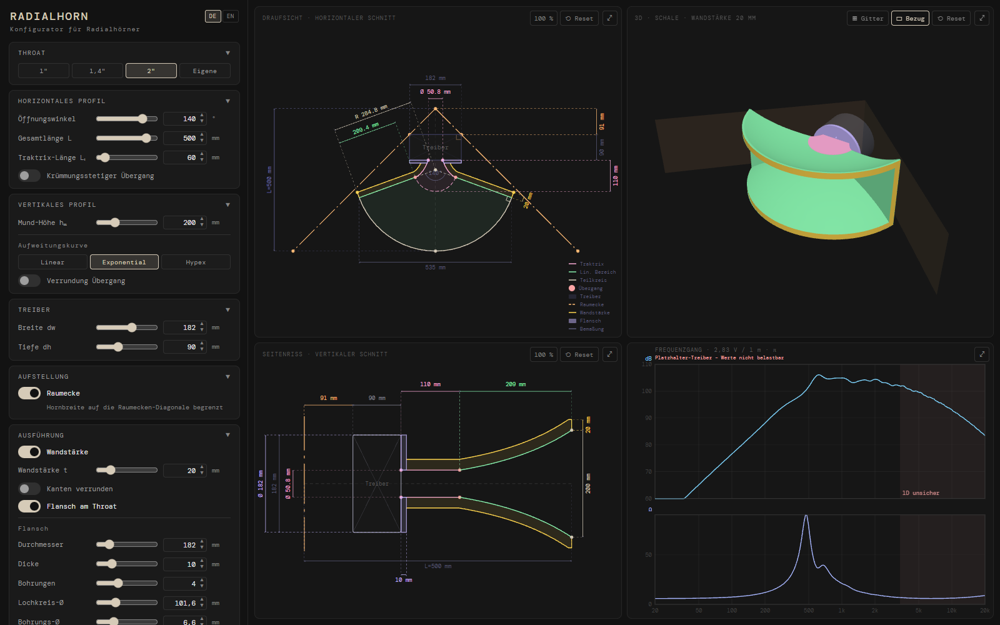

# Radialhorn

[English](README.md) · **Deutsch**

[](https://github.com/GurkeBoy/radialhorn/actions/workflows/ci.yml)

Desktop-App zur Auslegung von **Radialhörnern mit Traktrix-Eingang** für den Lautsprecher-Eigenbau. Aus wenigen
Parametern berechnet sie die Horngeometrie, zeichnet maßstäbliche Draufsicht und Seitenriss mit Bemaßung, zeigt das
Horn in 3D, simuliert den Frequenzgang und exportiert DXF für CAD, STL für den 3D-Druck und ein PDF-Datenblatt.



## Download

Installer für **Windows**, **macOS** (Apple Silicon und Intel) und **Linux** (.deb, .rpm, AppImage) hängen an jedem
[Release](https://github.com/GurkeBoy/radialhorn/releases). Sie sind nicht signiert:

- **Windows:** SmartScreen warnt eventuell – *Weitere Informationen → Trotzdem ausführen*.
- **macOS:** Meldet macOS die App als beschädigt oder lässt sie sich nicht öffnen, einmal im Terminal
  `xattr -cr /Applications/Radialhorn.app` ausführen.
- **Linux:** Das AppImage vor dem Start ausführbar machen.

## Funktionen

- **Horizontales Profil:** Traktrix-Eingang → gerade Wand unter dem halben Öffnungswinkel → Mundbogen um den
  Fokuspunkt; optional krümmungsstetiger Übergang (Klothoide) zwischen Traktrix und Wand. Öffnungswinkel,
  Gesamtlänge, Traktrix-Länge, Throat (1", 1,4", 2" oder eigene Größe) und Treibermaße einstellbar.
- **Vertikales Profil:** Aufweitung linear, exponentiell oder Hypex; optionale Verrundung des Übergangs Throat →
  Aufweitung.
- **Raumecke:** begrenzt die Hornbreite auf die 45°-Diagonale einer Raumecke, optional mit Wandstärke.
- **Ansichten:** Draufsicht und Seitenriss mit Bemaßung, Zoom (Mausrad), Verschieben (Ziehen) und Vollbild;
  Querschnittsfläche A(z) als Diagramm.
- **3D-Ansicht:** das Luftvolumen oder – mit Wandstärke – die Schale des Horns zum Drehen und Zoomen, als Fläche oder
  Gitter, mit Treiber und Raumecke als Bezug.
- **Ausführung:** Wandstärke, gerundete Außenkanten und ein runder Flansch am Throat mit Bohrbild zum Anschrauben des
  Treibers.
- **Frequenzgang (1D-Simulation):** Webster-Horngleichung per Transfermatrizen aus der Wellenfrontfläche S(x);
  Treiber mit Thiele-Small-Parametern und Kompressionskammer; Abstrahlung in 2π (exakt) oder 4π / π / π/2 (Näherung).
  SPL bei 1 m / 2,83 V und elektrische Impedanz als Diagramm, Export als CSV.
- **Kennwerte:** Mundfläche, vertikaler Öffnungswinkel, Grenzfrequenzen (Näherung).
- **Export:** DXF mit exakten Kurven (SPLINE/ARC/LINE statt Polylinien, damit CAD glatte Körper erzeugt), STL der
  Schale bzw. des Luftvolumens und PDF-Datenblatt mit maßstäblichen Zeichnungen.
- **Projektdateien:** Entwurf als `*.radialhorn.json` speichern, wieder öffnen oder weitergeben; beim Öffnen wird jeder Wert geprüft.
- **Deutsch und Englisch** umschaltbar; Einstellungen bleiben zwischen den Sitzungen erhalten.

## Validierung

Der 1D-Rechenkern ist an Fällen mit bekannter Lösung getestet (Resonanzen eines Rohrs, unendlicher Konus und
Exponentialtrichter, Energieerhaltung, Konvergenz) und **mit [Hornresp](http://www.hornresp.net/) abgeglichen**: Für
ein Konushorn, ein Konushorn mit Kompressionskammer und ein Horn aus Konus + Exponentialabschnitt stimmen SPL und
elektrische Impedanz an allen 533 Frequenzen von 10 Hz bis 20 kHz mit Hornresp überein (SPL auf 0,01 dB). Die
Vergleiche laufen bei jedem Testlauf mit, siehe [validation/](validation/README.md).

## Grenzen

- Die Simulation ist **eindimensional** (Webster) und nimmt eine kugelförmige Wellenfront an. Oberhalb von etwa
  c / (2 · Halsbreite) sind im Hals Querwellen möglich; das Diagramm markiert diesen Bereich als „1D unsicher“. Über
  das Abstrahlverhalten sagt sie nichts.
- Das Wellenfrontmodell im Traktrix-Bereich und am ebenen Hals ist eine Annahme, nicht durch Messung oder
  3D-Simulation geprüft.
- Wandverluste sind noch nicht berücksichtigt.
- Die Simulation startet mit einem **Platzhalter-Treiber**; für aussagekräftige Ergebnisse die Daten des eigenen
  Treibers eintragen.

## Entwicklung

Voraussetzungen: Node.js (24), Rust und die [Tauri-Voraussetzungen](https://tauri.app/start/prerequisites/).

```bash
npm install
npm run tauri dev    # Desktop-App
npm run dev          # nur Web-Oberfläche, http://localhost:1420
npm test             # Tests (Vitest)
npm run lint         # ESLint
npm run tauri build  # Installer bauen
```

Aufbau, Konventionen und Bemaßungsregeln: [CLAUDE.md](CLAUDE.md). Weitere Sprachen brauchen nur ein Wörterbuch in
[`src/locales/`](src/locales/) – ein Test prüft, dass kein Schlüssel fehlt.

## Lizenz

[MIT](LICENSE) © 2026 Julius Schirmer

Fremdbestandteile: Die Schrift [DM Mono](https://github.com/googlefonts/dm-mono) ist unter der
[SIL Open Font License 1.1](src/assets/fonts/OFL.txt) eingebettet. Hornresp ist ein eigenständiges Programm von David
J McBean; dieses Projekt steht in keiner Verbindung dazu und enthält nur berechnete Hornresp-Ergebnisse als
Referenzdaten, mit freundlicher Genehmigung von David J McBean.
