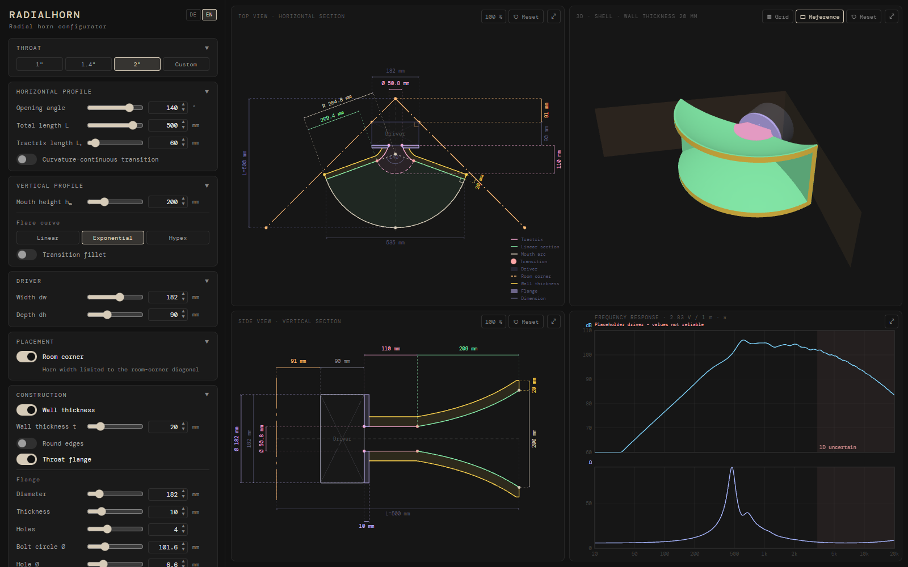

# Radialhorn

**English** · [Deutsch](README.de.md)

[](https://github.com/GurkeBoy/radialhorn/actions/workflows/ci.yml)

A desktop app for designing **radial horns with a tractrix entrance** for DIY loudspeakers. From a handful of
parameters it computes the horn geometry, draws scaled top and side views with dimensions, shows the horn in 3D,
simulates its frequency response, and exports DXF for CAD, STL for 3D printing and a PDF datasheet.



## Download

Installers for **Windows**, **macOS** (Apple Silicon and Intel) and **Linux** (.deb, .rpm, AppImage) are attached to
each [release](https://github.com/GurkeBoy/radialhorn/releases). They are not code-signed:

- **Windows:** SmartScreen may warn – *More info → Run anyway*.
- **macOS:** if the app is reported as damaged or cannot be opened, run `xattr -cr /Applications/Radialhorn.app` once in
  Terminal.
- **Linux:** make the AppImage executable before starting it.

## Features

- **Horizontal profile:** tractrix entrance → straight wall at half the opening angle → mouth arc around the focal
  point; optional curvature-continuous transition (clothoid) between tractrix and wall. Opening angle, total length,
  tractrix length, throat (1", 1.4", 2" or custom) and driver dimensions are adjustable.
- **Vertical profile:** linear, exponential or hypex flare; optional fillet at the transition throat → flare.
- **Room corner:** limits the horn width to the 45° diagonal of a room corner, optionally including wall thickness.
- **Views:** top view and side view with dimensions, zoom (mouse wheel), pan (drag) and fullscreen; cross-section
  area A(z) as a chart.
- **3D view:** the air volume or – with wall thickness – the horn shell, to rotate and zoom, as surfaces or wireframe,
  with driver and room corner as reference.
- **Construction:** wall thickness, rounded outer edges, and a round throat flange with a bolt pattern for mounting
  the driver.
- **Frequency response (1D simulation):** Webster horn equation solved by transfer matrices from the wavefront area
  S(x); driver from Thiele-Small parameters with throat (compression) chamber; radiation into 2π (exact) or 4π / π /
  π/2 (approximation). SPL at 1 m / 2.83 V and electrical impedance as a chart, export as CSV.
- **Key figures:** mouth area, vertical opening angle, approximate cutoff frequencies.
- **Export:** DXF with exact curves (SPLINE/ARC/LINE instead of polylines, so CAD builds smooth solids), STL of the
  shell or air volume, and a PDF datasheet with scaled drawings.
- **Project files:** save a design as `*.radialhorn.json`, open it again or share it; values are checked on opening.
- **English and German**, switchable; settings are kept between sessions.

## Validation

The 1D solver is tested against cases with known solutions (cylindrical pipe resonances, infinite cone and
exponential horn, energy conservation, convergence) and **compared with [Hornresp](http://www.hornresp.net/)**: for
a conical horn, a conical horn with throat chamber, and a conical + exponential horn, SPL and electrical impedance
match Hornresp at all 533 frequencies from 10 Hz to 20 kHz (SPL within 0.01 dB). These comparisons run as part of the
test suite – see [validation/](validation/README.md) (in German).

## Limitations

- The simulation is **one-dimensional** (Webster). It assumes a spherical-cap wavefront; above roughly
  c / (2 · throat width) cross modes can form in the throat, and the chart marks that range as “1D uncertain”. It says
  nothing about directivity.
- The wavefront model in the tractrix region and at the planar throat is an assumption that has not been verified
  by measurement or 3D simulation.
- Wall losses are not modelled yet.
- The simulation ships with a **placeholder driver**; enter the data of your own driver for meaningful results.

## Development

Requirements: Node.js (24), Rust and the [Tauri prerequisites](https://tauri.app/start/prerequisites/).

```bash
npm install
npm run tauri dev    # desktop app
npm run dev          # web UI only, http://localhost:1420
npm test             # tests (Vitest)
npm run lint         # ESLint
npm run tauri build  # build installers
```

Architecture, conventions and dimensioning rules are documented in [CLAUDE.md](CLAUDE.md) (in German).
New UI languages need only a dictionary in [`src/locales/`](src/locales/) – a test checks that no key is missing.

## License

[MIT](LICENSE) © 2026 Julius Schirmer

Third-party: the [DM Mono](https://github.com/googlefonts/dm-mono) font is embedded under the
[SIL Open Font License 1.1](src/assets/fonts/OFL.txt). Hornresp is a separate program by David J McBean; this project is
not affiliated with it and includes only numerical Hornresp results as reference data.
